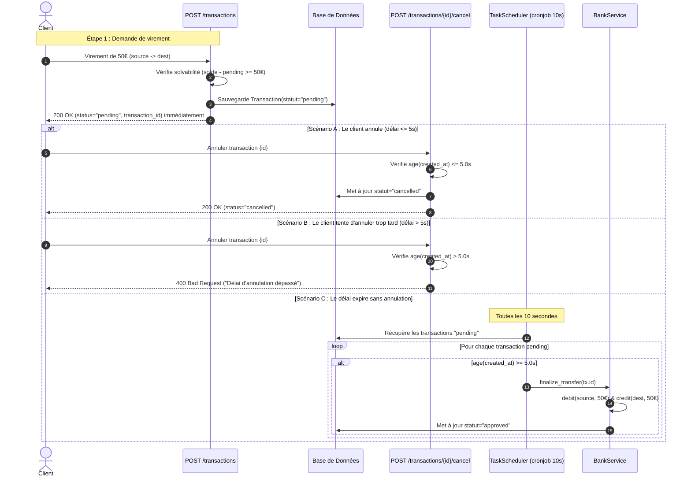

# Documentation Technique & Architecturale de l'API Bancaire

Ce document détaille le fonctionnement complet de l'application suite au refactoring architectural basé sur les principes **SOLID (ISP, SRP)**, la **Clean Architecture** et le traitement asynchrone des transactions (**Story 10**).

---

## 1. Vue d'Ensemble & Principes Architecturaux

L'application a été réorganisée en couches indépendantes avec inversion de dépendance :

```
                  ┌───────────────────────────────┐
                  │    Couche Présentation (API)  │
                  │            main.py            │
                  └───────────────┬───────────────┘
                                  │ (injecte via Depends)
                  ┌───────────────▼───────────────┐
                  │    Couche Métier (Services)   │
                  │     services/bank_service.py  │
                  └───────────────┬───────────────┘
                                  │ (dépend des interfaces)
                  ┌───────────────▼───────────────┐
                  │      Contrats d'Interfaces    │
                  │   repositories/interfaces.py  │
                  └───────────────▲───────────────┘
                                  │ (implémenté par)
            ┌─────────────────────┴─────────────────────┐
            │                                           │
┌───────────┴──────────┐                     ┌──────────┴──────────┐
│   Adaptateurs SQL    │                     │   Adaptateurs Fake  │
│ repositories/sql_repo│                     │repositories/fake_repo│
└──────────────────────┘                     └─────────────────────┘
```

### Principes SOLID appliqués :
1. **Interface Segregation Principle (ISP)** : Scission du God Repository en 4 interfaces dédiées ([`AccountRepository`](repositories/interfaces.py), [`TransactionRepository`](repositories/interfaces.py), [`BeneficiaryRepository`](repositories/interfaces.py), [`UserRepository`](repositories/interfaces.py)). Aucun client n'est forcé de dépendre de méthodes inutiles.
2. **Single Responsibility Principle (SRP)** : Les dépôts n'effectuent que de la persistance pure (`get`, `save`, `create`). Les règles métiers (clôture de compte, calcul de transfert, débits/crédits) sont centralisées dans [`BankService`](services/bank_service.py).
3. **Dependency Inversion Principle (DIP)** : Le service métier et les routes FastAPI dépendent d'abstractions (`typing.Protocol`) définies dans `repositories/interfaces.py` et non d'implémentations concrètes.

---

## 2. Rôle des Fichiers et Organisation des Couches

| Fichier / Dossier | Couche | Responsabilité |
| :--- | :--- | :--- |
| `repositories/interfaces.py` | **Contrats** | Définit les protocoles purs (`AccountRepository`, `TransactionRepository`, `BeneficiaryRepository`, `UserRepository`). |
| `services/bank_service.py` | **Métier** | Orchestre les opérations bancaires complexes : clôture avec transfert de solde, dépôts, finalisation atomique des virements. |
| `repositories/sql_repo.py` | **Infrastructure (SQL)** | Implémente la persistance SQLite via SQLModel pour chaque domaine. |
| `repositories/fake_repo.py` | **Infrastructure (Test)** | Implémente la persistance en mémoire (dictionnaires/listes) pour des tests unitaires ultra-rapides. |
| `scheduler.py` | **Tâche de Fond** | Exécute le cronjob `TaskScheduler` toutes les 10 secondes pour finaliser les transactions validées. |
| `dependencies.py` | **Inversion de contrôle** | Résout dynamiquement les dépôts (SQL ou Fake) et instancie `BankService` via `Depends()`. |
| `main.py` | **Présentation** | Points d'entrée HTTP FastAPI recevant les requêtes et déléguant aux services/repositories. |

---

## 3. Fonctionnement de l'Annulation de Transaction & TaskScheduler (Story 10)

Le cycle de vie d'une transaction suit fidèlement le schéma asynchrone bancaire :



### Détail des routes et composants :

1. **`POST /transactions`** :
   - Vérifie la solvabilité en tenant compte des transactions déjà en attente : `source.solde - pending_amount >= montant`.
   - Enregistre la transaction avec `statut = "pending"`.
   - **Retourne immédiatement** sans bloquer le client (`asyncio.sleep` supprimé).

2. **`POST /transactions/{id}/cancel`** :
   - Calcule l'âge : `(now - tx.created_at).total_seconds()`.
   - Si $\le 5$ secondes : passe le statut à `"cancelled"`.
   - Si $> 5$ secondes : renvoie une erreur `HTTP 400` car la période de rétractation est close.

3. **`TaskScheduler` (`scheduler.py`)** :
   - Démarré dans le `lifespan` FastAPI à l'initialisation du serveur.
   - Tourne en boucle toutes les 10 secondes (configurable via `TASK_SCHEDULER_INTERVAL_SECONDS`).
   - Sélectionne toutes les transactions `pending`.
   - Pour celles dont l'âge $\ge 5$ secondes, appelle `BankService.finalize_transfer` qui débite le compte émetteur, crédite le destinataire et passe le statut à `"approved"`.

---

## 4. Clôture de Compte & Dépôt (Via `BankService`)

### Clôture de compte (`POST /accounts/{id}/close`) :
1. La route `cloturer_compte` vérifie les autorisations (utilisateur propriétaire, compte non principal, aucune transaction en attente).
2. Elle délègue à `BankService.close_account` :
   - Récupère le compte principal de l'utilisateur.
   - Si le solde du compte à fermer est $> 0$, il crédite le compte principal et crée une transaction de type `"CLOTURE"` approuvée automatiquement.
   - Marque `is_closed = True` et remet le solde du compte fermé à `0.0`.
   - Persiste les modifications via `account_repo.save()`.

### Dépôt d'argent (`POST /accounts/{id}/deposit`) :
1. La route vérifie que le compte n'est pas clôturé et appartient à l'utilisateur connecté.
2. Elle délègue à `BankService.deposit` :
   - Exécute `credit(account, montant)`.
   - Crée une transaction de type `"DEPOT"` approuvée.
   - Sauvegarde le compte et la transaction via leurs repositories respectifs.

---

## 5. Comment tester & valider

La suite de tests unitaires et d'intégration couvre l'intégralité du système :
```bash
# Dans le virtualenv :
.venv/bin/python -m unittest tests/test_api.py
```

### Ce qui est vérifié :
- Inscription, connexion JWT et profil (`/register`, `/login`, `/me`).
- Création automatique du compte principal avec 100€ à l'inscription (Story 11).
- Consultation des comptes ordonnés par date décroissante (`.order_by(created_at.desc())`).
- Dépôts bancaires et historique de transactions.
- Virement immédiat en attente, annulation sous 5s, refus d'annulation après 5s, et traitement automatique par le TaskScheduler en arrière-plan (Story 10).
- Clôture de compte secondaire avec virement vers le compte principal (Story 12).
- Détail sécurisé d'une transaction (Story 13).
- Ajout et liste de bénéficiaires avec détection de doublons (Stories 14 & 15).
- Exécution des suites complètes en mode mémoire (`USE_SQL=false`) et en mode SQLite réel (`USE_SQL=true`).
